# The field app and admin console

I designed and built this field-sales system for a beverage company's sales
team: a mobile app that reps use in the field, and a web console that managers
and admins use in the office. It runs in production, and its data model is the
one this analysis uses.

The screens below are the real system running on the **synthetic FieldPulse
data** in this repository. The product name, brands and all data are replaced;
no company data or source code is published here.

**What I did:** gathered requirements from sales reps, ASMs and management;
designed the data model (stores, grades, visit plans, approvals, visits);
built the app and console; set up deployment, testing and data imports; and
built the dashboards managers use to track coverage.

**Stack:** React Native (Expo) for Android and web/PWA · React + Vite admin
console · PostgreSQL (Supabase) with row-level security · offline-first sync.

## Mobile app (sales reps and ASMs)

| | | |
|---|---|---|
| 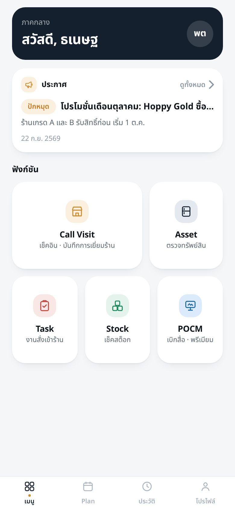 |  |  |
| **Home.** Announcements and the day's tools. | **Store list.** Coverage this month (58 of 60 stores), grade, last visit. | **Check-in.** GPS must be within 100 m of the store before a visit can start. |
| 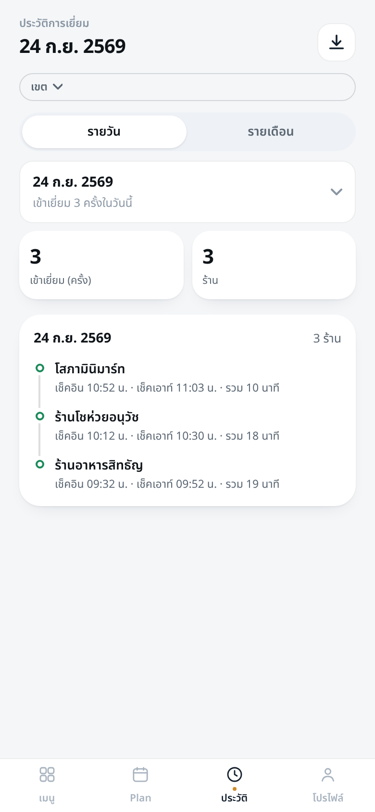 | 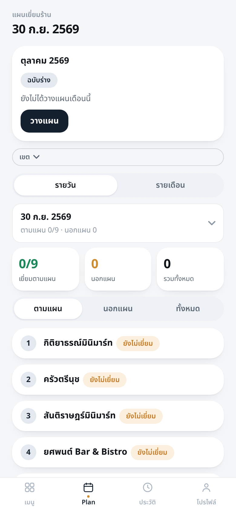 | 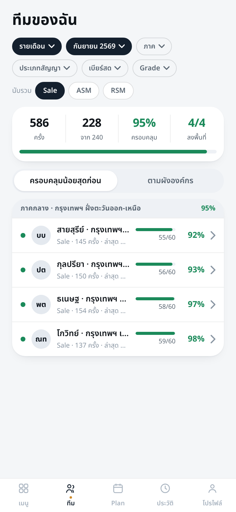 |
| **History.** Each visit with check-in, check-out and time in store. | **Visit plan.** The month's planned route, day by day. | **Team (ASM).** Coverage per rep, lowest first. |
| 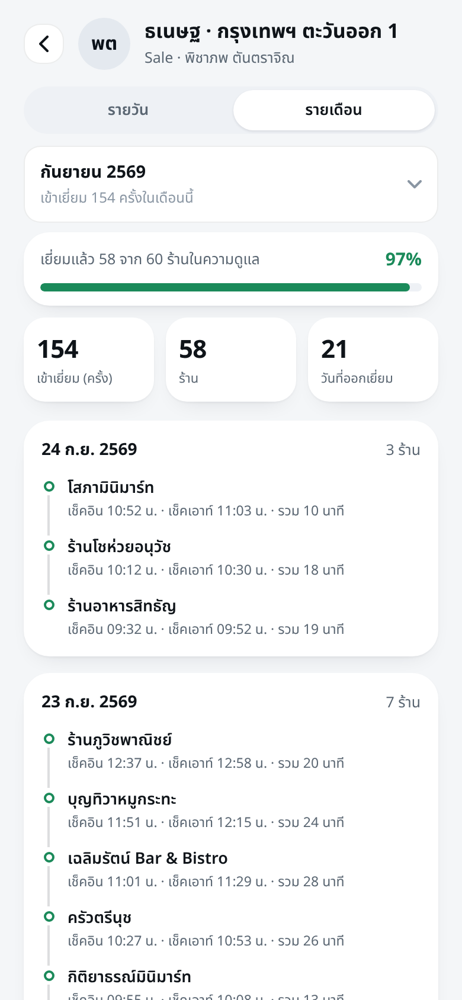 | 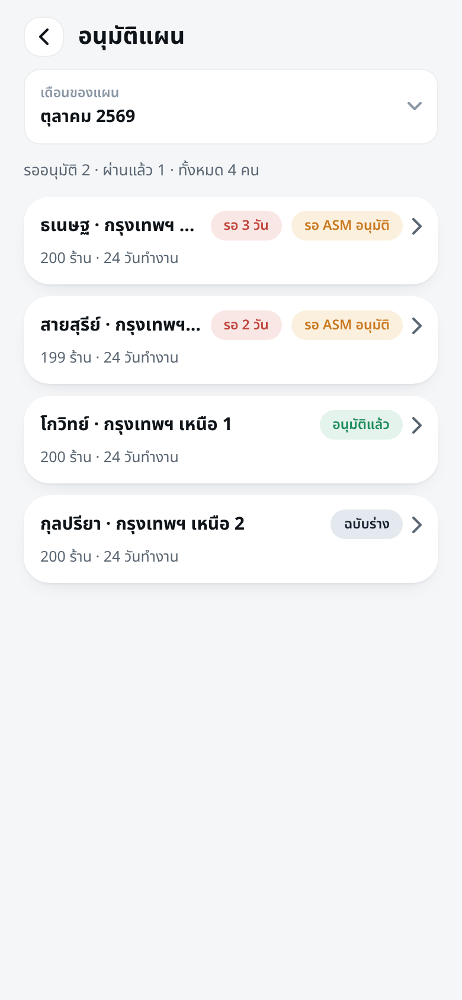 | |
| **Rep detail (ASM).** One rep's month: visits, stores covered, field days. | **Plan approval (ASM).** Next month's plans waiting for approval. | |

## Admin console (managers and sales operations)

**Visit dashboard:** coverage, visits per day against target, coverage by grade
and by rep.


**Outlet analysis:** visit objectives, store segments, coverage of key account groups.

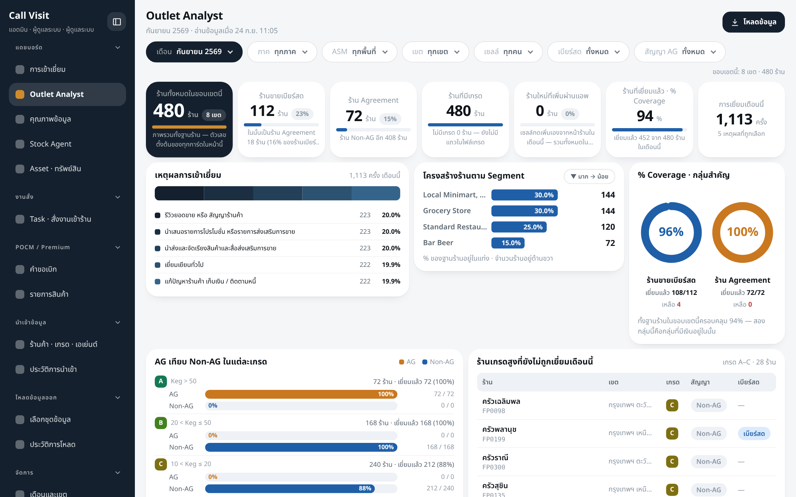

| | |
|---|---|
| 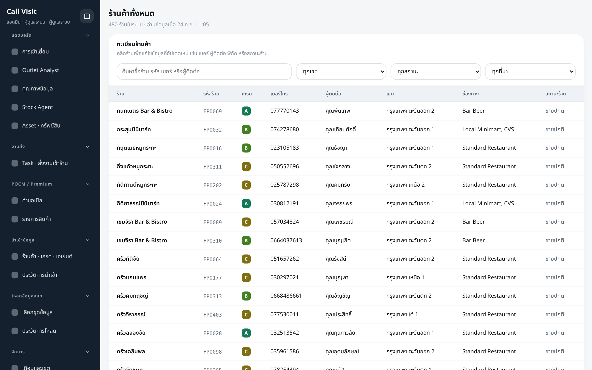 | 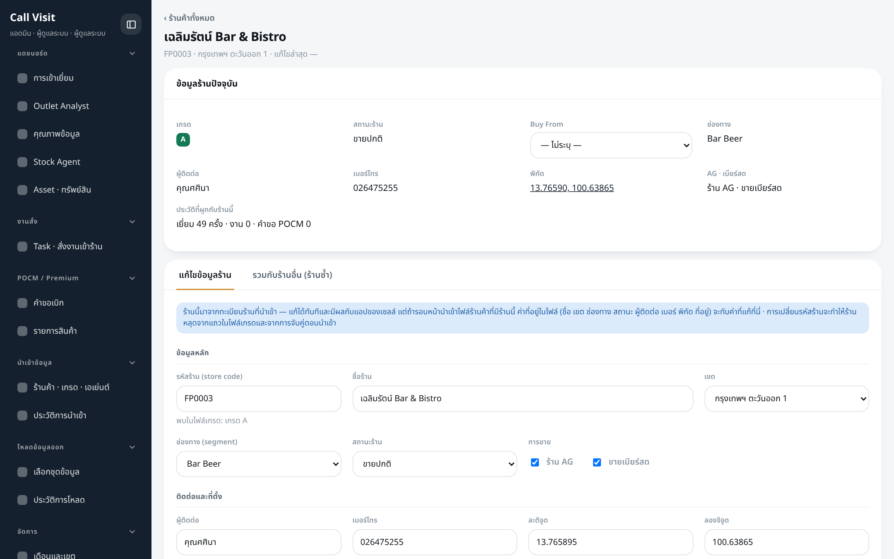 |
| **Store master:** search and filter all 480 stores. | **Store detail:** edit a store's data and see its visit history. |
| 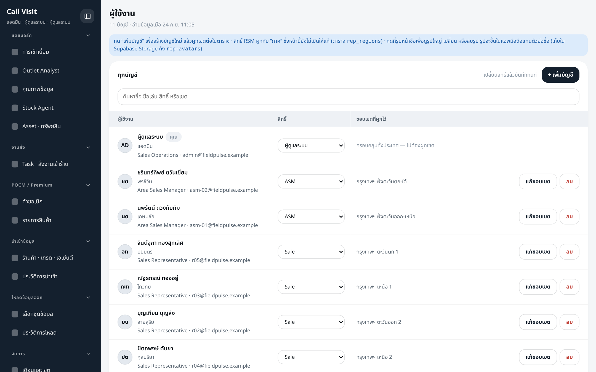 | 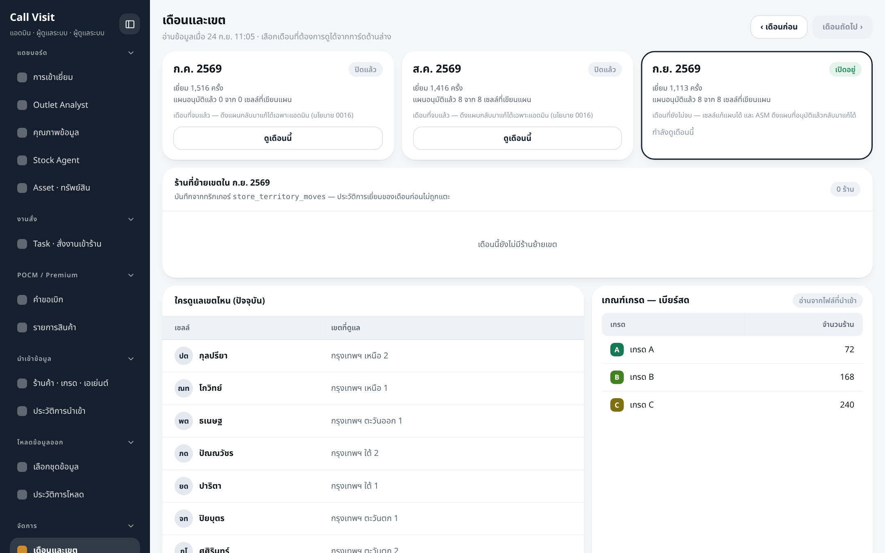 |
| **Users:** roles and territories. | **Months and territories:** close a month, see territory assignments. |

## How the data flows

```
Mobile app (rep)                 PostgreSQL                       Admin console / this analysis
check-in, GPS, photo   ──sync──▶  visits, visit_plans, stores  ──▶  dashboards, Excel export,
visit plan                        (row-level security by role)       SQL + Python analysis
offline queue on the phone
```

The tables in [`sql/01_schema.sql`](../../sql/01_schema.sql) mirror what the app
records: plans approved by an ASM, visits with GPS check-in and check-out, and
store grades that set how often each store should be visited.
